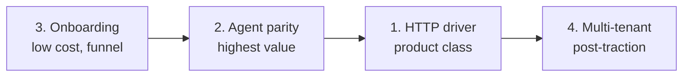

# IDEA — Fork Differentiation

Fork philosophy, one page. Four candidate theses, ranked. Pick **one** as the fork identity; the rest are backlog, not commitments.

Constraints that shape every option:

- Upstream (`d4ncboz/museai`) owns a public `TODO.md` roadmap. Any item already listed there is a *race*, not a moat — unless this fork ships it first and keeps shipping.
- Rebase cost is real. `drivers/browser/` (~840 lines across `driver.py`, `dom.py`, `cdp.py`, `chromium.py`) is the most volatile part of upstream. Divergence there = permanent conflict tax.
- Safe divergence = additive: new driver, new route, new script, new module. Never refactor shared core to make a fork-only feature fit.
- Baseline claims below that are not measured are marked **[estimate]**.

---

## 1. HTTP driver — delete Chromium

**Thesis.** muse.ai is a normal authenticated web app. Driving it through headless Chromium is an implementation shortcut, not a protocol requirement. A direct HTTP/WebSocket client makes this the only model gateway in the niche that runs on a 512 MB VPS or an ARM box.

**Why it changes the product class, not just a feature.**

| | browser driver | http driver |
|---|---|---|
| Docker image | `python:3.12-slim` + `chromium` + `fonts-wqy-zenhei` → **400–600 MB** [estimate] | slim + `httpx`/`websockets` → **80–120 MB** [estimate] |
| RAM per account | full renderer process, **250–400 MB** [estimate] | a few MB of buffers |
| Cold start | 2–5 s (launch + hydrate + 45 s ready timeout worst case) | < 1 s |
| Failure surface | selectors, locale strings, hydration state, page crashes, CDP socket drops | HTTP status + auth |
| Parallelism | 1 context/account, CPU-bound | hundreds of concurrent streams |
| ARM / small VPS | painful | trivial |

**Evidence it is feasible, already in-repo.**

- `src/museai/upstream/muse.py` already talks to the backend **over plain HTTP**: `GET /api/session` (cookie rotation via `Set-Cookie`) and `POST /api/hatch/vm/wake`. Auth is just a cookie header — no browser-only token.
- `HttpDriver` stub exists with `capabilities = DriverCapabilities(renew_session=True)` and a documented work breakdown (`src/museai/drivers/http/driver.py`).
- `registry.create_driver` and `Settings.driver` already accept `"http"`, so **zero core change** is needed to switch drivers.
- The browser driver exists only because the chat transport was unknown, not because HTTP was blocked.

**Work.**

1. Capture the web client transport after `POST` a message: endpoint, framing (SSE / WebSocket / long-poll), event names, and the workspace (`hatch_vml`) header. Write `docs/protocol.md`. This is the whole project's critical path — everything else is mechanical.
2. `drivers/http/client.py`: httpx client factory per account, cookie merge from `Account.cookies`, cookie rotation writeback, `UpstreamAuthError`/`UpstreamQuotaError` mapping.
3. `chat_stream`: open thread (`/thread/new` equivalent), send message, map discrete upstream events → text deltas, honor `first_token_timeout`, `cancel`, and `req.turns` reuse. Emit a stall event instead of silently hanging.
4. Media: `generate_image` / `generate_video` → submit, poll task, download attachment into `core/media.py`.
5. Fixture tests: recorded transcripts replayed from `tests/fixtures/`, no live traffic in CI. Same shape as `MockDriver` tests today.
6. Keep `browser` driver as fallback for one release, behind the same `MuseDriver` ABC. Delete only when http passes everything.

**Acceptance.**

- `MUSE2API_DRIVER=http` serves a full streamed completion with a real cookie set.
- Image + video round-trip produce files under `data/media`.
- Image built from the existing `Dockerfile` minus the `chromium` install is under 150 MB.
- `pytest` green with zero browser processes.

**Cost / risk.** Highest engineering of the four (transport reverse-engineering is unknown-unknowns). Upstream can change the protocol silently — mitigate with a protocol doc plus a live canary test. B1 is on upstream's own TODO, so this is a race; being first plus keeping the driver maintained is the moat.

**Positioning.** "muse.ai gateway that doesn't need a browser." One-sentence differentiator, immediately verifiable by `docker images`.

---

## 2. OpenAI parity for coding agents — tool calling, `/v1/responses`, stream keepalive

**Thesis.** Without `tools` support the gateway cannot serve Codex, Claude Code, Cline, Aider, or any OpenAI-agents client. `ChatCompletionRequest.tools` is currently accepted and ignored (`api/schemas.py`), which is worse than rejecting it — the client thinks it can call tools and gets plain prose.

**Why it wins on market.** All four theses share users; this one targets the largest and most demanding segment (people already paying for agent tools) and it is *not* on upstream's roadmap as a shipped feature, only as C3/C1/C4 stubs.

**Work.**

1. **Emulated tool calling (`core/prompt.py` + `core/tools.py`).** Append a compact tool contract to the system prompt: JSON schema, "reply with a single `{"tool_calls":[…]}` object and nothing else when a tool is needed". Parse the first JSON object from the reply; if it matches, emit `finish_reason: "tool_calls"` with `tool_calls[].function.arguments` as a JSON string; otherwise plain content. Stream path: buffer until the object closes, so partial JSON never leaks to the client as text.
   - Constraint: re-encode tool results into the next turn as text (the upstream has no `tool` role). Requires `message_turns` to fold `role: "tool"` messages — currently `core/prompt.py` flattens them as plain text.
   - Do not try to be perfect: agents retry. Deterministic parse + a strict "no prose alongside tool_calls" rule beats clever heuristics.
2. **`/v1/responses`.** Map `input` (string or item list) + `instructions` → `flatten_messages`; emit `response.created`, `response.output_text.delta`, `response.completed`. Stateless only — no `store`, no `previous_response_id`. Fixes the stub at `api/routes/responses.py`.
3. **Keepalive (`api/routes/chat.py`).** SSE comment `: ping\n\n` every 15 s on idle. Long upstream thinking currently trips 60 s client timeouts in several UIs. One loop, one line inside it.

**Acceptance.**

- A tool-loop client (e.g. one real agent run with two tools) completes end to end and executes a returned tool call.
- `POST /v1/responses` streaming matches the OpenAI event names for a text-only run.
- A 120 s upstream think time does not drop the client connection.

**Cost / risk.** Medium. Emulation is inherently approximate: some tool JSON will not parse, agents will occasionally see prose. Document the fidelity limit in the README instead of hiding it. Keep the parser dependency-free.

**Positioning.** "Works with Codex/Claude Code/Cline out of the box." Highest perceived value per line of code.

---

## 3. Onboarding — cookie import pipeline

**Thesis.** The gap between "repo demo" and "product" is the moment a user has to open DevTools and copy five cookie values by hand. Every competitor that solved this grew; every one that did not stayed a GitHub curiosity.

**Work.**

1. **Extend `scripts/extract_cookies.py` / `D1`** to accept: Netscape `cookies.txt` (already), Chrome DevTools JSON, Playwright `storage_state.json`, Selenium/undetected output, and a raw `Cookie:` header string. One `parse_any(text) -> dict` with format sniffing, plus tests per format.
2. **Browser extension (`extension/`, MV3, ~150 lines).** `chrome.cookies.getAll({domain: "muse.ai"})` → filter to the five known names → `POST /admin/accounts` with the admin key. No build step, no permissions beyond `cookies` + host access.
3. **One-command path.** `museai import-cookies ./cookies.txt` as a `pyproject.toml` script, so setup is `pip install -e . && museai import-cookies`, no curl.
4. **Fail loudly.** Map each missing cookie to an actionable message (`hatch_native_auth_device` missing → "re-export from a device that has actually logged in"). Today the user just gets a 401 upstream.

**Acceptance.**

- Five input formats parse to the same account dict; one test each.
- Extension inserts an account and `/admin/status` shows it active.
- Missing `hatch_sess` produces a specific error naming the cookie.

**Cost / risk.** Low technical, medium operational (extension store approval is avoidable — ship unpacked, document "Load unpacked"). This is the funnel; without it the other three theses have no users.

**Positioning.** "Setup in 30 seconds." Good README headline, screenshots cheap.

---

## 4. Multi-tenant — API keys, rate limits, durable store

**Thesis.** Today the gateway is single-user: one `MUSE2API_API_KEY`, `data/accounts.json`, one process. That is correct for local use and blocks every other use (shared gateway, team instance, hosted endpoint).

**Work.**

1. **`D4` store.** Implement `SqliteAccountStore` against the existing `AccountStore` protocol (`accounts/store.py`) — schema is `accounts(id, label, status, cookies json, expires json, meta json)`. JSON stays the default; SQLite is opt-in via `MUSE2API_STORE=sqlite`. Redis is out of scope until someone needs it.
2. **`E2` keys.** `data/keys.json` → `[{key, label, scopes, rpm, created}]`; `require_api_key` reads it, falling back to the single env key. Constant-time compare (`hmac.compare_digest`) — already the pattern to preserve.
3. **Rate limit.** Token bucket in process, per key per minute, plus the existing per-account concurrency. In-memory is fine: one process. Mark it `ponytail:`-style — no Redis, no distributed limiter until there is a second process.
4. **Per-key usage.** Increment counters on completion (`requests`, `tokens_approx`, `failovers`) → `GET /admin/usage`. Do not build a dashboard; JSON only.

**Acceptance.**

- Two keys, one rate-limited, one normal: isolation proven by test.
- Restart mid-flight keeps accounts and counters (SQLite path).
- JSON path still works unchanged for single-user installs.

**Cost / risk.** Low technical, low payoff *today*. Only worth it once the fork is actually used by more than one person — otherwise it is premature architecture. That is why it ranks last.

**Positioning.** None on its own. It is a prerequisite for hosting, not a reason to choose this fork.

---

## Sequencing

Rationale: onboarding is days of work and makes every other thesis testable by real users. Agent parity converts users into regulars. The HTTP driver is the identity change and can run in parallel as a spike (protocol capture first — if capture fails, thesis dies cheaply). Multi-tenant waits for demand.

## Guardrails

- One thesis per release; write it in the README headline or drop it.
- Never edit `drivers/browser/`, `drivers/base.py`, or `core/prompt.py` for fork-only behavior unless the change is also upstreamable. Prefer a fork module plus a thin switch.
- Every divergence gets one line in a fork changelog, so `git log upstream/main..HEAD` matches intent.
- If an idea proves good, send it upstream. A fork that keeps its diffs small survives upstream churn; a fork that rewrites core does not.
